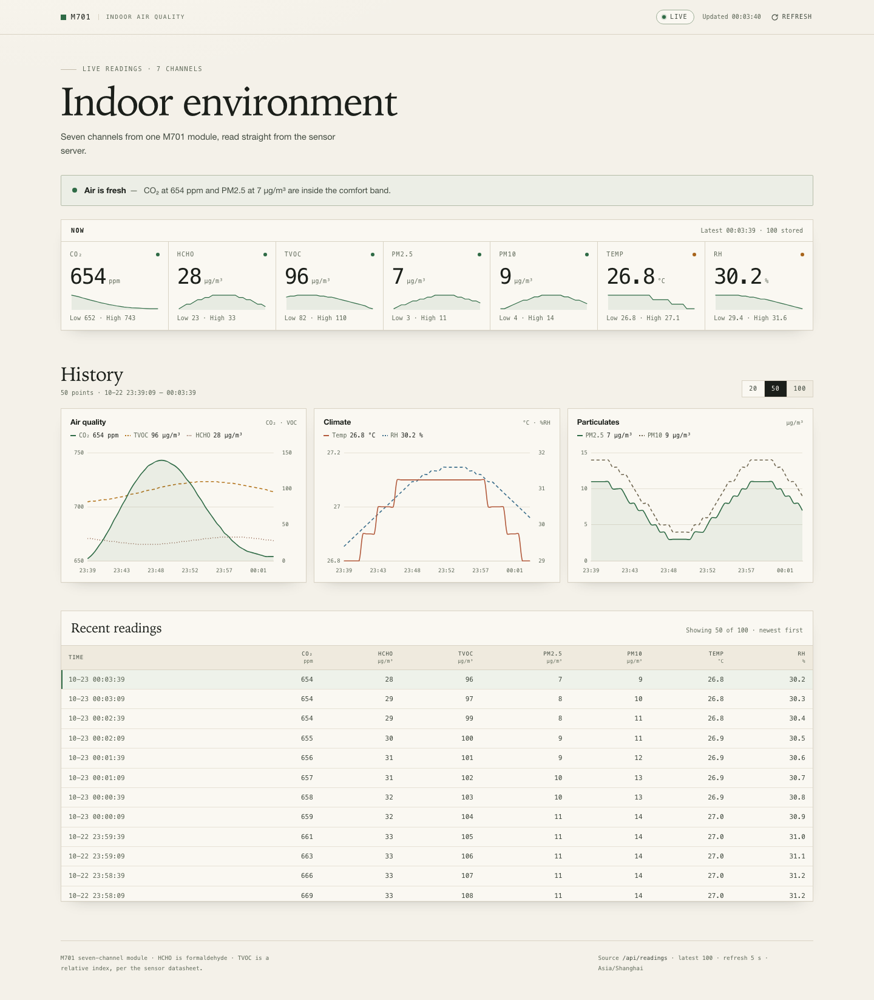

# Sensor

An M701 seven-channel indoor air quality monitor, end to end:

- **client/** — Rust serial reader for the M701 module (CO₂, HCHO, TVOC, PM2.5, PM10, temperature, humidity)
- **server/** — Axum + PostgreSQL API and the live dashboard
- **docs/** — M701 frame specification and dashboard preview

**Live dashboard:** <https://sensor.boxcube.xyz>



```
M701 sensor ──USB serial──▶ client ──HTTPS POST──▶ server ──▶ PostgreSQL
                                                     │
                                                     └──▶ dashboard
```

## Layout

| Path | Contents |
| :--- | :--- |
| `client/` | `sensor_reader` Rust binary |
| `server/` | `sensor_server` API, dashboard assets, Docker Compose stack |
| `deploy/` | Cloudflare Tunnel and systemd unit templates |
| `docs/` | Hardware notes and screenshots |

Both original repositories were imported with `git subtree`, so their full commit
histories are still present under `client/` and `server/`.

## Quick start

Server (needs PostgreSQL):

```bash
cd server
cp .env.example .env
cargo run
```

Client (Linux, sensor on `/dev/ttyACM0`):

```bash
cd client
cargo run --release -- --port /dev/ttyACM0 --server-url http://127.0.0.1:3000/api/readings
```

Set `SENSOR_API_KEY` in the environment (or a `.env` file) on both sides.

## Deployment

`server/docker-compose.yml` runs PostgreSQL, the API, and Caddy as a local
reverse proxy. Public HTTPS is terminated by the Cloudflare Tunnel for
`sensor.boxcube.xyz`; the tunnel forwards to Caddy on `127.0.0.1:8080`.
See [deploy/README.md](deploy/README.md). The current box runs the no-sudo
fallback documented in [deploy/rootless/README.md](deploy/rootless/README.md);
the Compose stack is ready to replace it when Docker access is granted.

## API

| Method | Path | Auth |
| :--- | :--- | :--- |
| `GET` | `/api/readings` | public, latest 100 rows |
| `POST` | `/api/readings` | `x-api-key` header |

The client posts a 17-byte M701 frame decoded into:

```json
{
  "eco2": 731,
  "ech2o": 89,
  "tvoc": 235,
  "pm2_5": 22,
  "pm10": 27,
  "temperature": 21.4,
  "humidity": 41.1
}
```

## Hardware

The M701 outputs 17-byte UART frames at 9600 baud. The field map is documented in
[docs/m701-frame-spec.ini](docs/m701-frame-spec.ini); the full datasheet lives in
[client/docs](client/docs).
